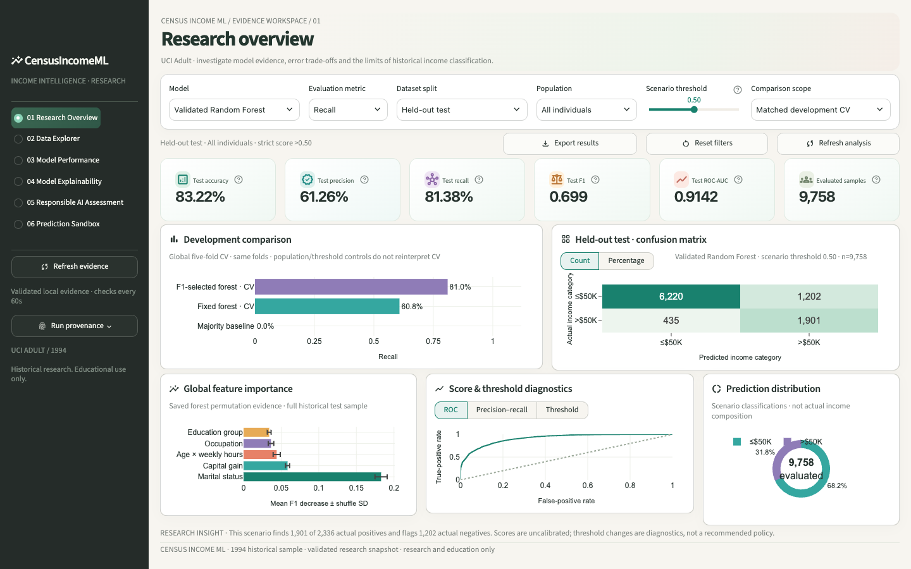
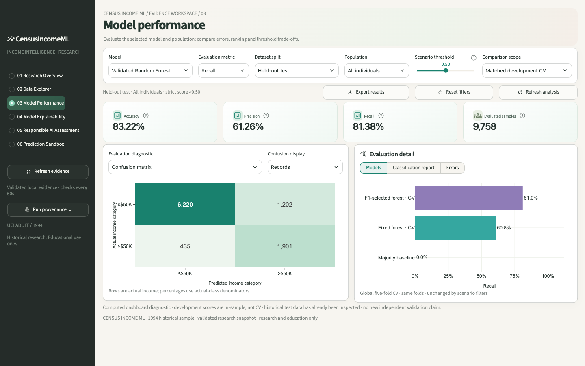
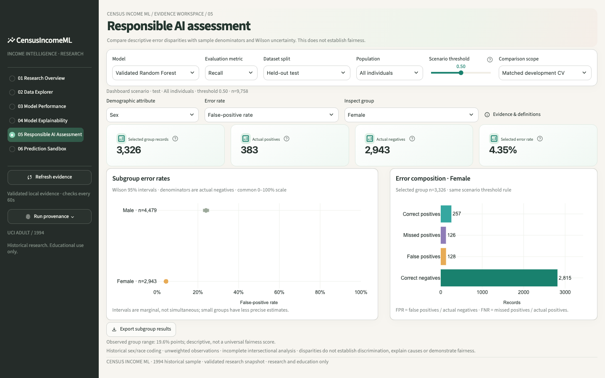
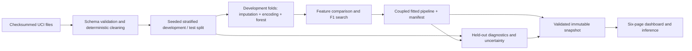

# CensusIncome ML — model trade-offs you can inspect

A historical income-classification study with a reproducible ML pipeline and a six-page analytical dashboard. The saved forest finds **81.38%** of >$50K records at **61.26% precision**, with **0.9142 ROC-AUC**—a useful example of why accuracy alone hides an important precision–recall trade-off.



**Start here:** [research notebook](notebooks/01_income_classification_research.ipynb) · [research report](docs/RESEARCH_REPORT.md) · [interview defense](docs/INTERVIEW_DEFENSE.md) · [audit evidence](docs/portfolio_audit/REPORT.md)

## The question

How do census features and F1-based forest selection change the balance between missed positives and false alarms? Can those results be traced through cleaning, fold-local preprocessing, model selection, evaluation and the exact pipeline used by an interactive app?

This is a portfolio study of evaluation and engineering on UCI Adult, not a service for estimating present-day income. The data are historical, scores are uncalibrated, and demographic disparities remain. It must not guide employment, lending or eligibility decisions.

## What the evidence shows

| Saved evaluation | Accuracy | Precision | Recall | F1 | ROC-AUC |
|---|---:|---:|---:|---:|---:|
| Majority-negative baseline, same test records | 76.06% | 0* | 0 | 0 | 0.5000 |
| Fixed forest, five-fold development CV | 86.05% | 76.10% | 60.77% | 0.6760 | 0.9136 |
| F1-selected forest, same development folds | 83.40% | 61.68% | 81.03% | 0.7004 | 0.9124 |
| Saved selected forest, held-out reproduction | **83.22%** | **61.26%** | **81.38%** | **0.6990** | **0.9142** |

*Zero precision is the documented zero-division convention when the baseline predicts no positives. CV rows and test rows are different evaluation scopes; they are not interchangeable.

- The selected model trades lower accuracy and precision for greater recall and F1. It does not dominate the fixed forest on every metric.
- On 9,758 test records: **6,220 TN, 1,202 FP, 435 FN, 1,901 TP**. “83% accurate” alone omits both error types.
- Marital status and capital gain have the largest saved permutation importance. This describes model reliance, not causes of income or an individual explanation.
- Demographic error rates differ substantially. Removing direct sex/race inputs does not eliminate proxies or establish fairness.

The test set has been inspected before; these are faithful historical results, not a new independent validation claim. See [model card](docs/model_card.md) and [data card](docs/data_card.md).

## Run the saved dashboard — no training needed

Use this directory as the repository root and Python **3.12**:

```sh
python3.12 -m venv .venv
source .venv/bin/activate
# Windows PowerShell: .venv\Scripts\Activate.ps1
python -m pip install -r requirements-lock.txt
python scripts/publish_run.py
python -m streamlit run app/main.py
```

The source checkout, raw public UCI files, reports and small trusted model are included. Installation is editable; installing a wheel alone does not supply those external assets. The snapshot publication command validates and copies existing evidence locally; it neither trains nor publishes online. First uncached dashboard scoring takes roughly 20 seconds on the audited Mac.

The app provides shared model/split/population/threshold controls, cohort cross-filtering, diagnostics, global explanations, subgroup uncertainty, public-data browsing and a hypothetical prediction sandbox. Thresholds affect explicitly labelled scenarios; they do not overwrite saved research. Desktop 1440×900 fits without page scrolling; tablet layouts reflow vertically.

## Dashboard screenshots

| Model performance | Responsible AI assessment |
|---|---|
| [](docs/images/model-performance.png) | [](docs/images/responsible-ai.png) |

Click either screenshot for a full-size view. The Research Overview is shown above.

## Verify the project

```sh
python -m pip check
python -m pytest -q
python scripts/audit_project.py --output /tmp/census-frozen-audit
```

The default suite is self-contained for this repository. One separately marked historical **enclosing-workspace** preservation check expects files outside the repository, including an already missing original `.gitignore`; it is not a release test. `python -m pytest -m workspace` runs that historical check explicitly. Its original manifest and known gap are retained, not rewritten to manufacture a pass.

For full model comparisons, search and diagnostics in a **fresh kernel and isolated copy**:

```sh
python scripts/verify_research.py --record-differences
```

This executes all 14 notebook code cells, four feature groups across five folds, the 12-candidate search, saved-pipeline inference, calibration, permutation and subgroup diagnostics. It creates a separate notebook/reports under `docs/portfolio_audit/reproduction/`; its refitted model is never promoted to the dashboard. Omit `--record-differences` to require exact historical reconciliation.

**Cross-platform finding:** the 2026-10-24 Mac rerun selects the same feature group and parameters but does not match archived Windows metrics at 1e-6. Eleven test classifications change, for a net three additional correct predictions (83.2548% accuracy versus 83.2240%). Repeated Mac fits produce the same classes. The precise low-level cause has not been isolated; exact seeded refit equivalence across these environments is not claimed. The frozen dashboard model and its metrics remain unchanged. [Details and fresh execution evidence](docs/portfolio_audit/REPORT.md).

Do not run the training notebook or training CLI against the authoritative release just to launch the app. The isolated verification runner is the safe route for repeating research.

## Architecture and workflow



Learned preprocessing fits within each CV training fold. Education bins and age×hours are deterministic, record-local transformations inside the pipeline. A separate integrity-checked snapshot keeps reports, source data and predictions on the same run. The UI never trains.

```text
app/          Six pages and shared UI/scenario logic
src/          Data, preprocessing, training, evaluation and inference package
notebooks/    Narrative research notebook with historical executed outputs
reports/      Preserved validated research evidence
artifacts/    Small trusted model + manifest and historical references
scripts/      Local publication, audits and isolated research verification
tests/       Scientific, integrity, state and UI regressions
docs/        Report, data/model cards, interview guide and current audit
```

## Scientific limits

The 48,842 UCI records are pooled and 52 exact full-record duplicates removed. The 48,790 remaining rows are split into 39,032 development and 9,758 test records, not the original UCI test partition. Metrics are unweighted by `fnlwgt` and are not population estimates. Two full 14-predictor profiles cross this preserved split with conflicting labels; person-level independence is unestablished.

Feature-group selection and tuning reuse the same five folds, so the selected CV score is optimistic rather than nested-CV evidence. The 12-candidate search is limited. Importance is not causal; threshold scenarios are not test-selected policies. Fixed-bin calibration diagnostics do not calibrate the model. Small subgroup/intersectional denominators limit fairness conclusions. External contemporary validation remains future work.

## Data, licensing and artifact trust

Becker, B. & Kohavi, R. (1996), *Adult*, [UCI Machine Learning Repository](https://archive.ics.uci.edu/dataset/2/adult), [DOI 10.24432/C5XW20](https://doi.org/10.24432/C5XW20). Data: CC BY 4.0; software: [MIT](LICENSE). See [NOTICE](NOTICE).

Only load maintainer-created artifacts. Checksums and dependency checks catch accidental corruption and incompatibility, not an attacker who replaces both model and manifest. Joblib is not a safe format for untrusted uploads. No credentials are required. The public copy redacts workstation paths and omits machine-specific diagnostic metadata; execution uses checkout-relative paths. See [publication notes](docs/PUBLICATION_NOTES.md).

## GitHub preparation

Use the prepared project folder described in [release instructions](docs/GITHUB_RELEASE.md), not the enclosing NBA workspace or `.venv`. GitHub Actions runs project checks on pushes and pull requests; consult the repository’s Actions tab for its current status. Cloud hosting and production readiness are separate, unverified scopes. The commit history records actual publication and subsequent changes.
